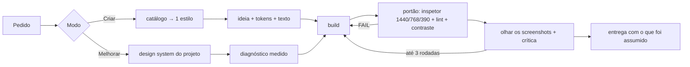

<div align="center">

# Atelier

**Design de produto de verdade, não "cara de IA".**

Uma skill para Claude Code (e outros agentes) que cria, melhora e revisa interfaces e peças visuais
decidindo antes de pintar, medindo num navegador real e olhando o resultado antes de entregar.

`landing pages` · `sites` · `dashboards` · `telas de app` · `componentes` · `design system` · `carrosséis`

</div>

---

## Por que existe

Peça uma landing a um modelo e você recebe a média de todas as landings que ele já viu: título
centralizado, rótulo pequeno em cima, três cards com ícone, um gradiente roxo, depoimento inventado.
Nada está errado e nada foi decidido.

O Atelier troca esses padrões por decisões:

- **Uma referência real como base.** Um catálogo de estilos (Apple, Linear, Notion, Ramp, Revolut, Wise…)
  em formato DESIGN.md. Um estilo por peça, sem misturar.
- **A ideia vem do assunto, não da categoria.** Inventário do cliente e o *teste do concorrente*: se a ideia
  serve para o concorrente, ela é genérica.
- **Regras medidas, não esperadas.** Inspetor em navegador real a 1440, 768 e 390px: título, margens,
  contraste, overflow, vazios. Corrige até zerar os FAILs.
- **Olhar o que foi feito.** Screenshots obrigatórios, crítica com nota e até 3 rodadas de correção.
- **Nada inventado.** Sem números, depoimentos, logos ou clientes falsos.

## Cinco modos

| Você pede | Modo | O que acontece |
|---|---|---|
| "Faz uma landing para…" | **Criar** | Inventário → argumento → estilo → ideia → tokens → texto → build → portão → movimento |
| "Melhora a sidebar / o botão / esta tela" | **Melhorar** | Lê o design system do projeto, diagnostica com medidas, muda o mínimo e mostra antes/depois |
| "Revisa o design disso" | **Revisar** | Render + crítica + checklist de código no formato `arquivo:linha`, sem mexer em nada |
| "Carrossel / post sobre…" | **Social** | Slides em HTML, export nativo 2160×2700, galeria de versões, `carrossel.zip` |
| "Monta os tokens / tema escuro" | **Sistema** | Tokens primitivo → semântico → componente, claro e escuro validados |

**Melhorar não é redesenhar.** Pediu o botão, muda o botão. Problema no tema inteiro? O Atelier avisa e
propõe, não altera sozinho.

## Landing pages que vendem

Bonita não basta: landing precisa converter. Para isso, o Atelier trabalha junto com a skill
**[lp-validate](https://github.com/leonardoperin14/skill-validatelp-richard)**, que diagnostica por que uma
LP não converte usando o framework de 10 etapas de Richard ([@richardrx](https://x.com/richardrx)).

| Etapa | Quem faz |
|---|---|
| Público, origem do tráfego, nível de consciência, promessa | `lp-validate` (`brief`) |
| Narrativa, prova e objeções, oferta, CTA, formulário | `lp-validate` |
| Estilo, tipografia, cor, layout, imagens, responsivo | Atelier |
| Diagnóstico depois do build | `lp-validate` (`diagnose`) + portão do Atelier |

**Contexto antes de pixel:** em página de venda, o Atelier não desenha o hero antes de saber quem chega,
de onde e sabendo o quê. Sem a `lp-validate` instalada, ele faz essas perguntas por escrito.

## Instalação

### Com o `npx skills`

```bash
npx skills add https://github.com/unmartim/atelier --skill atelier
```

### Como plugin do Claude Code

```text
/plugin marketplace add unmartim/atelier
/plugin install atelier@atelier
```

### Manual

```bash
git clone https://github.com/unmartim/atelier.git
cp -r atelier/skills/atelier ~/.claude/skills/
```

### Skills parceiras (recomendadas)

```bash
# diagnóstico de conversão de landing pages
git clone https://github.com/leonardoperin14/skill-validatelp-richard.git ~/.claude/skills/lp-validate
```

### Requisitos

| Precisa | Para |
|---|---|
| Node 22+ e Chrome, Edge ou Chromium | inspetor, lint e direções |
| Python 3 | base de consulta de UX, paletas e fontes |
| Playwright (`npm i -D playwright && npx playwright install chromium`) | render de social e componentes |

Falta algum? A skill usa o que houver e diz o que não conseguiu rodar.

### Estilos (DESIGN.md)

Os DESIGN.md são da [Refero Styles](https://styles.refero.design) e **não vêm no repositório**. Baixe os
que quiser e salve em `skills/atelier/estilos/<id>.md` usando os ids do [`catalogo.md`](skills/atelier/catalogo.md).
Passo a passo em [`estilos/README.md`](skills/atelier/estilos/README.md). Sem eles, o Atelier usa a
descrição do catálogo como direção.

## Experimente

```text
Melhora a sidebar do meu painel, está com cara de template.
Faz uma landing para uma clínica de estética no estilo Apple.
Revisa o design desta página sem mexer em nada.
Carrossel de 5 slides sobre agentes de IA.
```

## Como funciona



**Quem manda, em ordem:** o pedido e a marca → o design system do projeto → o estilo escolhido → as regras
da casa → as bases de consulta (sugestões, nunca ordens).

## Estrutura

```text
skills/atelier/
├── SKILL.md              # o procedimento
├── catalogo.md           # índice dos estilos, lido primeiro
├── estilos/              # seus DESIGN.md (não versionados)
├── marcas/               # fichas das marcas + peças aprovadas
├── references/           # regras da casa, melhorar, revisar, escrita, tokens, responsivo, receitas, carrossel
├── scripts/              # render.mjs (desktop/mobile/2x + zip), check.mjs (contraste AA, cores)
└── vendor/               # ferramentas de terceiros, com licença
```

## Créditos

O Atelier é construído sobre o trabalho de outras pessoas:

- [taste-skill](https://github.com/Leonxlnx/taste-skill) de Leonxlnx: direções, inspetor, lint e crítica (MIT)
- [ui-ux-pro-max](https://github.com/nextlevelbuilder/ui-ux-pro-max-skill) da Next Level Builder: base de UX, paletas, fontes e stacks (MIT)
- [wshobson/agents](https://github.com/wshobson/agents): padrões de design system e responsivo (MIT)
- [frontend-design](https://github.com/anthropics/skills) da Anthropic: ideias de processo e escrita (Apache-2.0)
- [Web Interface Guidelines](https://github.com/vercel-labs/web-interface-guidelines) da Vercel, buscadas na hora da revisão
- [Refero Styles](https://styles.refero.design): formato DESIGN.md e estilos de referência
- [lp-validate](https://github.com/leonardoperin14/skill-validatelp-richard) de leonardoperin14, sobre o framework de Richard (@richardrx): skill parceira de conversão, usada junto e não copiada

Detalhes em [`CREDITOS.md`](skills/atelier/CREDITOS.md).

## Licença

[MIT](LICENSE). As partes em `vendor/` mantêm as licenças originais de cada projeto.
